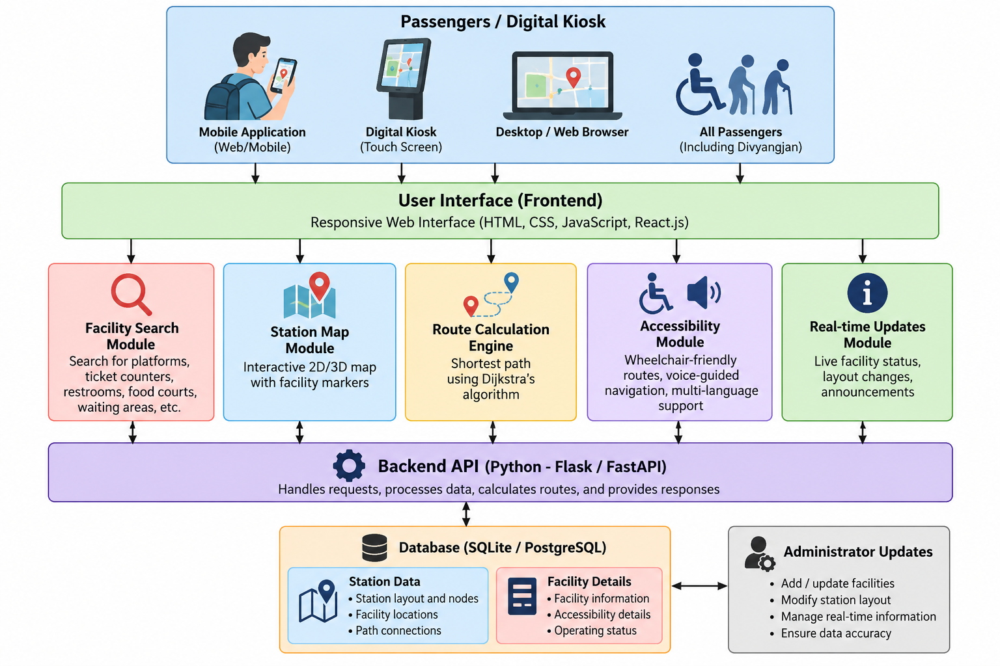

# Smart India Hackathon Workshop
# Date: 26-10-2026
## Register Number: 212224040321
## Name: SIRISHA P
## Problem Title
SIH 1710: Enhancing Navigation for Railway Station Facilities and Locations
## Problem Description
Background: Railway stations are complex environments with numerous facilities and locations such as ticket counters, platforms, restrooms, food courts, and waiting areas. Passengers often face difficulties in navigating these spaces, especially in large or unfamiliar stations. Efficient and user-friendly navigation systems are crucial for improving passenger experience, reducing congestion, and ensuring timely travel connections. Description: The problem involves developing a comprehensive navigation solution for railway stations that assists passengers in locating various facilities and destinations within the station premises. This includes creating detailed maps, providing real-time directions, and integrating features such as accessibility options for individuals with disabilities. The solution should be intuitive, easy to use, and accessible via multiple platforms, including mobile devices and digital kiosks. Key challenges include updating navigation information in real-time, ensuring accuracy, and accommodating the diverse needs of all passengers. Expected Solution: The expected solution is a multi-platform navigation system that provides detailed, real-time directions to all facilities and locations within a railway station. This system should include: A mobile application with 3D interactive maps and step-by-step navigation. Digital kiosks located throughout the station with touch-screen interfaces. Voice-guided navigation for visually impaired passengers. Regular updates to reflect changes in station layout and facility locations. Integration with existing railway apps and services for seamless user experience. The solution should enhance the overall passenger experience by reducing confusion, saving time, and improving accessibility within the station.

## Problem Creater's Organization
Ministry of Railway

## Idea
RailGuide – Smart Indoor Navigation for Railway Stations

RailGuide is a passenger-friendly navigation platform designed to help travellers locate facilities and navigate railway station premises easily. Users can select their current location and destination to receive a route with clear directions and estimated walking distance.

The system will provide searchable facility categories, interactive station maps, accessible route options, and voice instructions for visually impaired passengers. A kiosk-friendly interface will allow the same system to be used on digital information screens within railway stations.

The initial prototype will use a sample station map and predefined routes. It can later be extended with real station floor plans, live facility updates, positioning technologies, and official railway service integrations.

## Proposed Solution / Architecture Diagram
Architecture

The proposed system consists of the following components:

User Interface: A responsive web application for mobile phones, tablets, desktops, and digital kiosks.

Facility Search Module: Allows passengers to search for platforms, ticket counters, restrooms, food courts, waiting rooms, lifts, and other facilities.

Station Map Module: Displays station locations, facility markers, and routes on an interactive map.

Route Calculation Engine: Calculates a path between the passenger's starting point and destination using a station navigation graph.

Accessibility Module: Provides wheelchair-accessible route options and voice-guided instructions.

Backend and Database: Stores station layouts, facility details, connections, and route information.

Update Module: Allows authorized administrators to update facility availability and station layout information.

Architecture Diagram
```

          PASSENGER / DIGITAL KIOSK
                     |
                     v
          RESPONSIVE USER INTERFACE
                     |
          +----------+-----------+
          |          |           |
          v          v           v
      Facility    Station     Accessibility
       Search       Map         Features
          |          |           |
          +----------+-----------+
                     |
                     v
             ROUTE ENGINE
          (Graph / Dijkstra)
                     |
                     v
              BACKEND API
                     |
                     v
                 DATABASE
          +----------+-----------+
          |                      |
          v                      v
    Station Locations       Facility Details
          |
          v
   ADMINISTRATOR UPDATES
```

## System Architecture of RailGuide – Smart Railway Station Navigation System


## Use Cases
1. Find a Platform: Passengers can locate their required platform and receive directions from their current location.

2. Find Station Facilities: Users can search for ticket counters, restrooms, food courts, waiting halls, drinking water, and enquiry counters.

3. Step-by-Step Navigation: The system provides a route with directional instructions and estimated walking distance.

4. Wheelchair-Accessible Navigation: Passengers can request routes that avoid stairs and prioritize available ramps and lifts.

5. Voice-Guided Navigation: Users can listen to navigation instructions through text-to-speech functionality.

6. Digital Kiosk Support: Passengers can use a touch-friendly interface at station information kiosks.

7. Facility Information: Users can view facility locations and any available information about accessibility or operating status.

8. Station Layout Updates: Authorized administrators can update maps, facility locations, and route connections.

9. Mobile-Friendly Access: Passengers can access the application through a mobile browser without installing a dedicated app.

10. Emergency Facility Search: Users can locate designated help desks, medical assistance points, and emergency exits when these locations are included in the verified station map

## Technology Stack

### Frontend

HTML5

CSS3

JavaScript

React.js for a component-based interface

Leaflet.js for map visualization where appropriate

### Backend

Python

Flask or FastAPI for REST APIs

### Database

SQLite for the initial prototype

PostgreSQL for a larger deployment

### Navigation

Graph-based station representation

Dijkstra's algorithm for shortest-path calculation

Accessibility-aware route filtering

### Accessibility

Web Speech API for browser-supported voice instructions

Text-to-speech navigation

Keyboard navigation and screen-reader-friendly interface

Development Tools

Visual Studio Code

Git and GitHub

Web browser developer tools

Postman for API testing

### Future Enhancements

Three-dimensional station maps

Indoor positioning using Bluetooth beacons or QR codes

Real-time lift and escalator status

Integration with verified railway service APIs

Multilingual voice instructions

## Dependencies
The initial prototype can use the following dependencies:

react – Builds the user interface.

react-dom – Renders the React application.

vite – Provides the development server and build tools.

leaflet – Supports interactive maps.

react-leaflet – Integrates Leaflet maps with React.

flask – Provides the Python backend API.

flask-cors – Allows frontend-backend communication during development.

networkx – Supports graph-based route calculations.

sqlite3 – Stores sample station and facility data using Python's standard library.

## Expected Outcome: 
A working prototype that helps passengers locate railway station facilities and follow calculated routes through an interactive, accessible interface. Real-time positioning, verified station layouts, and live operational updates will require additional data sources and integration work.